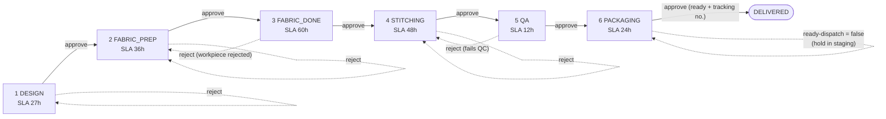

# Garment Order Tracking API

A backend API that tracks garment manufacturing orders. A client places an **order** (for example, 10 kitchen aprons). The order then moves through **6 production stages** (design, fabric prep, fabric finishing, stitching, QA, packaging) until it is `DELIVERED`. Every stage has an approve/reject gate, a time limit (SLA), and its own business rules (for example: a kitchen apron must not be made of polyester, because polyester is not heat resistant). Every action is saved as an event, so you can see the full timeline of an order.



Solid arrows are approvals, dotted arrows are rejects (each reject adds 1 to `rework_count` and restarts the stage clock). PACKAGING cannot be rejected.

## Tech stack

- Python 3.13, Django 5.2, Django REST Framework
- PostgreSQL 16 (Docker). SQLite is available for quick local runs only.
- drf-spectacular (OpenAPI schema + Swagger UI), django-filter
- pytest + pytest-django
- Docker Compose, gunicorn

## Project structure

```
.
├── config/                  Django settings, root URLs, wsgi/asgi
├── apps/
│   ├── common/              Shared plumbing
│   │   ├── exceptions.py        DomainError + error code -> HTTP status mapping
│   │   ├── exception_handler.py Turns every error into the {"error": {...}} envelope
│   │   └── views.py             GET /api/health/
│   ├── catalog/             Reference data: Pattern, Color, Inspection (plain CRUD)
│   └── orders/              The core of the project
│       ├── choices.py           Enums + workflow tables (next status, reject target, SLA hours)
│       ├── rules.py             Fabric compatibility table (pure functions, no DB)
│       ├── services.py          ALL business logic (create/update/delete/approve/reject/ready-dispatch)
│       ├── models.py            Order and OrderEvent (+ computed SLA properties)
│       ├── serializers.py       Request/response shapes only
│       ├── views.py             Thin HTTP layer
│       ├── filters.py           ?status= ?garment_type= ?overdue= filters
│       ├── urls.py              /api/orders/... and /api/fabric-rules/
│       ├── management/commands/seed_demo.py   Demo data loader
│       └── tests/               test_rules.py, test_services.py, test_api.py
├── docs/                    SPEC.md (source of truth), API.md, BUSINESS_LOGIC.md
├── docker-compose.yml       web (Django) + db (PostgreSQL)
├── docker-entrypoint.sh     Waits for the DB, runs migrations, starts the server
├── Makefile                 Shortcuts for common commands
└── .env.example             Environment variable template
```

### Why is the business logic in `services.py`? ("thin views, fat services")

Views only parse the request, call one service function, and serialize the result. All the rules (fabric compatibility, stage gates, reject routes, SLA clock) live in `apps/orders/services.py` and `rules.py`. This gives three benefits:

1. **One place to look.** To understand or change a rule, open one file instead of hunting through views, serializers and models.
2. **Easy to test.** Services are plain Python functions, so `test_services.py` tests every rule without making HTTP calls.
3. **Reusable.** The API, the `seed_demo` command and the tests all use the same functions, so the rules can never be bypassed by accident.

Services raise `DomainError(code, message, details)`; the exception handler converts it into an HTTP response. Services never build HTTP responses themselves. Every state change runs inside `transaction.atomic()` with the order row locked (`select_for_update()`), so two people cannot approve the same order at once.

## Setup (Docker)

### Prerequisites
- Docker Engine 24+ with Docker Compose v2.24+ (`docker compose version`). On Windows: Docker Desktop.
- Free ports: `8000` (API). PostgreSQL is not exposed to the host.

### Step by step

```bash
# 1. Get the code and enter the folder
cd chertam-assignment

# 2. (Optional) environment file - defaults work without it
cp .env.example .env

# 3. Build images and start PostgreSQL + API in the background
#    (the entrypoint waits for the DB and runs migrations automatically)
docker compose up --build -d

# 4. Check both containers are up (db should say "healthy")
docker compose ps

# 5. Load demo data (patterns, colors, inspections, 6 sample orders) - safe to run twice
docker compose exec web python manage.py seed_demo

# 6. Smoke test
curl http://localhost:8000/api/health/        # {"status":"ok"}

# 7. (Optional) run the full curl demo: one order from creation to DELIVERED
./scripts/demo_flow.sh
```

### Everyday Docker commands

| Task | Command |
|---|---|
| Start (foreground, see logs) | `docker compose up --build` |
| Start in background | `docker compose up --build -d` |
| Follow API logs | `docker compose logs -f web` |
| Stop containers (keep data) | `docker compose down` |
| Stop and **wipe the database** | `docker compose down -v` |
| Rebuild after changing requirements | `docker compose build --no-cache web` |
| Run migrations manually | `docker compose exec web python manage.py migrate` |
| Django shell | `docker compose exec web python manage.py shell` |
| Open psql | `docker compose exec db psql -U chertam -d chertam` |
| Run tests (against PostgreSQL) | `docker compose exec web pytest` |

### Troubleshooting
- **Port 8000 already in use** → stop the other process, or change `"8000:8000"` to e.g. `"8080:8000"` in `docker-compose.yml`.
- **`docker` not found inside WSL** → Docker Desktop → Settings → Resources → WSL Integration → enable your distro, then `wsl --shutdown`.
- **Want a clean slate** → `docker compose down -v && docker compose up --build -d && docker compose exec web python manage.py seed_demo`.

### Dependencies (frozen)
`requirements.txt` (runtime) and `requirements-dev.txt` (tests) pin exact versions, frozen from the `python:3.13-slim` image, so every build is reproducible. To upgrade: edit the direct dependency, rebuild, run the tests, then re-freeze with `docker compose exec web pip freeze`.

Want live code reload while developing? Use the dev overlay (mounts the source folder into the container):

```bash
docker compose -f docker-compose.yml -f docker-compose.dev.yml up --build
```

> **Windows + WSL:** the dev overlay mounts a WSL folder, so Docker Desktop's WSL integration must be enabled for your distro (Settings → Resources → WSL Integration). Without it you get `stat /run/guest-services/distro-services/<distro>.sock: no such file or directory`. The default `docker compose up` does not need it.

| What | URL |
|---|---|
| Swagger UI (try the API in the browser) | http://localhost:8000/api/docs/ |
| OpenAPI schema | http://localhost:8000/api/schema/ |
| Health check | http://localhost:8000/api/health/ |
| Django admin | http://localhost:8000/admin/ |

To log in to the admin, create a superuser:

```bash
docker compose exec web python manage.py createsuperuser
```

## Running tests

In Docker:

```bash
docker compose run --rm web pytest
```

Locally (no Docker, uses SQLite so no PostgreSQL is needed):

```bash
python -m venv .venv
. .venv/bin/activate
pip install -r requirements-dev.txt
DB_ENGINE=sqlite pytest
```

## Makefile commands

| Command | What it does |
|---|---|
| `make up` | `docker compose up --build -d` (start in background) |
| `make down` | Stop and remove containers |
| `make test` | Run pytest inside Docker |
| `make seed` | Load demo data |
| `make migrate` | Run migrations |
| `make shell` | Open the Django shell |
| `make logs` | Follow the web container logs |
| `make demo` | Run `scripts/demo_flow.sh`: one apron order end-to-end with curl (needs `make seed` first) |

## Environment variables

Copy `.env.example` to `.env` to override. All have defaults.

| Variable | Default | Meaning |
|---|---|---|
| `SECRET_KEY` | `dev-insecure-secret-key-change-me` | Django secret key. Change it in production. |
| `DEBUG` | `False` unless set (`.env.example` sets `true`) | Django debug mode |
| `ALLOWED_HOSTS` | `*` | Comma-separated allowed hosts |
| `POSTGRES_DB` | `chertam` | Database name |
| `POSTGRES_USER` | `chertam` | Database user |
| `POSTGRES_PASSWORD` | `chertam` | Database password |
| `POSTGRES_HOST` | `localhost` (set to `db` by docker-compose) | Database host |
| `POSTGRES_PORT` | `5432` | Database port |
| `DB_ENGINE` | `postgres` | Set to `sqlite` for local quick runs and tests without Docker |
| `SQLITE_PATH` | `<project>/db.sqlite3` | SQLite file path (only when `DB_ENGINE=sqlite`) |

## 2-minute walkthrough (curl)

Run `seed_demo` first (see Quick start). The demo data creates patterns 1-3, colors 1-3, inspections for every garment type (ids 3 and 4 are the HEAT_INSULATION checks) and 6 sample orders, so the new order below gets `id` 7. Your ids may differ if you changed the data; read them from the responses. Responses below are trimmed.

**1. Try a wrong fabric: polyester for a kitchen apron is rejected.**

```bash
curl -s -X POST localhost:8000/api/orders/ -H 'Content-Type: application/json' -d '{
  "name": "Kitchen apron", "garment_type": "HEAT_INSULATION", "fabric_type": "POLYESTER",
  "requester_username": "somchai", "address": "1 Sukhumvit Rd, Bangkok", "quantity": 10}'
```
```json
HTTP 400
{"error": {"code": "FABRIC_INCOMPATIBLE",
  "message": "POLYESTER cannot be used for HEAT_INSULATION garments.",
  "details": {"garment_type": "HEAT_INSULATION", "fabric_type": "POLYESTER",
              "allowed_fabrics": ["COTTON", "DENIM", "WOOL", "ARAMID"]}}}
```

**2. Create it again with cotton.**

```bash
curl -s -X POST localhost:8000/api/orders/ -H 'Content-Type: application/json' -d '{
  "name": "Kitchen apron", "garment_type": "HEAT_INSULATION", "fabric_type": "COTTON",
  "requester_username": "somchai", "address": "1 Sukhumvit Rd, Bangkok", "quantity": 10}'
```
```json
HTTP 201
{"id": 7, "status": "DESIGN", "pattern": null, "rework_count": 0,
 "sla_hours": 27, "sla_deadline": "2026-11-11T01:33:09+07:00", "is_overdue": false, "next_status": "FABRIC_PREP"}
```

**3. Approve DESIGN.** Without a pattern it fails (`PATTERN_REQUIRED`), so send `pattern_id`.

```bash
curl -s -X POST localhost:8000/api/orders/7/approve/ -H 'Content-Type: application/json' -d '{"actor": "designer1"}'
# HTTP 400  {"error": {"code": "PATTERN_REQUIRED", "message": "A pattern is required to approve the design.", "details": {}}}

curl -s -X POST localhost:8000/api/orders/7/approve/ -H 'Content-Type: application/json' -d '{"actor": "designer1", "pattern_id": 1}'
# HTTP 200  {"id": 7, "status": "FABRIC_PREP", "pattern": 1, "sla_hours": 36, "next_status": "FABRIC_DONE", ...}
```

**4. Approve FABRIC_PREP** (swatch must match the order's fabric; give measured meters).

```bash
curl -s -X POST localhost:8000/api/orders/7/approve/ -H 'Content-Type: application/json' \
  -d '{"actor": "buyer1", "swatch_fabric_type": "COTTON", "measured_fabric_meters": "25.50"}'
# HTTP 200  {"status": "FABRIC_DONE", "measured_fabric_meters": "25.50", "sla_hours": 60, ...}
```

**5. Approve FABRIC_DONE.** Finished fabric cannot be more than measured fabric.

```bash
curl -s -X POST localhost:8000/api/orders/7/approve/ -H 'Content-Type: application/json' \
  -d '{"actor": "dyer1", "color_id": 1, "finished_fabric_meters": "30"}'
# HTTP 400  {"error": {"code": "YIELD_EXCEEDS_MEASURED", ..., "details": {"finished_fabric_meters": "30.00", "measured_fabric_meters": "25.50"}}}

curl -s -X POST localhost:8000/api/orders/7/approve/ -H 'Content-Type: application/json' \
  -d '{"actor": "dyer1", "color_id": 1, "finished_fabric_meters": "24.00"}'
# HTTP 200  {"status": "STITCHING", "color": 1, "finished_fabric_meters": "24.00", "sla_hours": 48, ...}
```

**6. Approve STITCHING.** The number of assembled pieces must equal the quantity (10).

```bash
curl -s -X POST localhost:8000/api/orders/7/approve/ -H 'Content-Type: application/json' \
  -d '{"actor": "sewer1", "assembled_pieces_count": 10}'
# HTTP 200  {"status": "QA", "assembled_pieces_count": 10, "sla_hours": 12, ...}
```

**7. QA finds a problem: reject.** The order goes back to STITCHING and `rework_count` becomes 1.

```bash
curl -s -X POST localhost:8000/api/orders/7/reject/ -H 'Content-Type: application/json' \
  -d '{"actor": "qa1", "reason": "Loose stitching on seams"}'
# HTTP 200  {"status": "STITCHING", "rework_count": 1, ...}
```

Re-approve STITCHING (same body as step 6), then QA. QA must answer every inspection of the garment type (here ids 3 and 4):

```bash
curl -s -X POST localhost:8000/api/orders/7/approve/ -H 'Content-Type: application/json' \
  -d '{"actor": "qa1", "results": [{"inspection_id": 3, "passed": true}]}'
# HTTP 400  {"error": {"code": "INSPECTION_INCOMPLETE", ..., "details": {"missing_inspection_ids": [4]}}}

curl -s -X POST localhost:8000/api/orders/7/approve/ -H 'Content-Type: application/json' \
  -d '{"actor": "qa1", "results": [{"inspection_id": 3, "passed": true}, {"inspection_id": 4, "passed": true}]}'
# HTTP 200  {"status": "PACKAGING", "sla_hours": 24, "next_status": "DELIVERED", ...}
```

**8. PACKAGING.** Approving before the order is marked ready fails; mark it ready first.

```bash
curl -s -X POST localhost:8000/api/orders/7/approve/ -H 'Content-Type: application/json' \
  -d '{"actor": "packer1", "tracking_number": "TH123456789"}'
# HTTP 400  {"error": {"code": "NOT_READY_FOR_DISPATCH", "message": "Order is not marked ready for dispatch.", "details": {}}}

curl -s -X POST localhost:8000/api/orders/7/ready-dispatch/ -H 'Content-Type: application/json' \
  -d '{"actor": "packer1", "is_ready": true, "cartons_count": 3}'
# HTTP 200  {"status": "PACKAGING", "is_ready_dispatch": true, "cartons_count": 3, ...}

curl -s -X POST localhost:8000/api/orders/7/approve/ -H 'Content-Type: application/json' \
  -d '{"actor": "packer1", "tracking_number": "TH123456789"}'
# HTTP 200  {"status": "DELIVERED", "tracking_number": "TH123456789", "rework_count": 1,
#            "sla_hours": null, "sla_deadline": null, "is_overdue": false, "next_status": null, ...}
```

**9. See the timeline.**

```bash
curl -s localhost:8000/api/orders/7/events/
```
```json
[{"id": 27, "order": 7, "status": "DESIGN", "action": "CREATED", "actor": "somchai", "note": "", "data": {"name": "Kitchen apron"}},
 {"status": "DESIGN", "action": "APPROVED", "actor": "designer1", "data": {"pattern_id": 1}},
 ...
 {"status": "QA", "action": "REJECTED", "actor": "qa1", "note": "Loose stitching on seams", "data": {"from": "QA", "to": "STITCHING"}},
 ...
 {"status": "PACKAGING", "action": "READY_DISPATCH_SET", "actor": "packer1", "data": {"is_ready": true, "cartons_count": 3}},
 {"status": "PACKAGING", "action": "APPROVED", "actor": "packer1", "data": {"tracking_number": "TH123456789"}}]
```

## Design decisions & assumptions

- **Reading the Excalidraw diagram.** The diagram shows 6 steps with sub-tasks, each having an SLA. We map the steps to the statuses `DESIGN`, `FABRIC_PREP`, `FABRIC_DONE`, `STITCHING`, `QA`, `PACKAGING`, plus a terminal `DELIVERED`. A step that has an approve/reject decision became an approve/reject gate. The reject arrows were read as: design, fabric prep and stitching go back to themselves (redo the work); a rejected workpiece in step 3 goes back to step 2; failing QC in step 5 goes back to step 4; packaging has no reject, only "hold in the finished goods staging area" (`ready-dispatch` with `is_ready=false`).
- **SLA = sum of sub-task SLAs.** For example DESIGN = Designer 24h + Machine 3h = 27h; FABRIC_DONE = Combine 12h + Dyeing 48h = 60h. The clock (`stage_started_at`) restarts on every status change, including a reject back to the same status. `is_overdue` is computed, not stored, and is always `false` for DELIVERED.
- **No authentication.** The API is open (`AllowAny`) on purpose, to keep the assignment focused on the workflow. Instead, each write call carries an `actor` string that is saved in the event timeline. In a real system this would come from the logged-in user.
- **Garment type drives the rules.** The garment type chosen at step 1 limits the fabrics (table in `docs/BUSINESS_LOGIC.md`) and decides which QA inspections are required.
- **Errors are predictable.** Every error has the same envelope with a stable `code`. State conflicts return 409, other rule violations 400.
- **Deleting a Pattern or Color that an order still uses** is blocked with 409 `IN_USE`.
- **SQLite fallback is for quick local runs only** (`DB_ENGINE=sqlite`). Docker and production use PostgreSQL 16.

## More documentation

- [docs/API.md](docs/API.md): every endpoint, request/response examples, error codes
- [docs/BUSINESS_LOGIC.md](docs/BUSINESS_LOGIC.md): every business rule as a numbered case, with code and test references
- [docs/SPEC.md](docs/SPEC.md): the implementation spec
